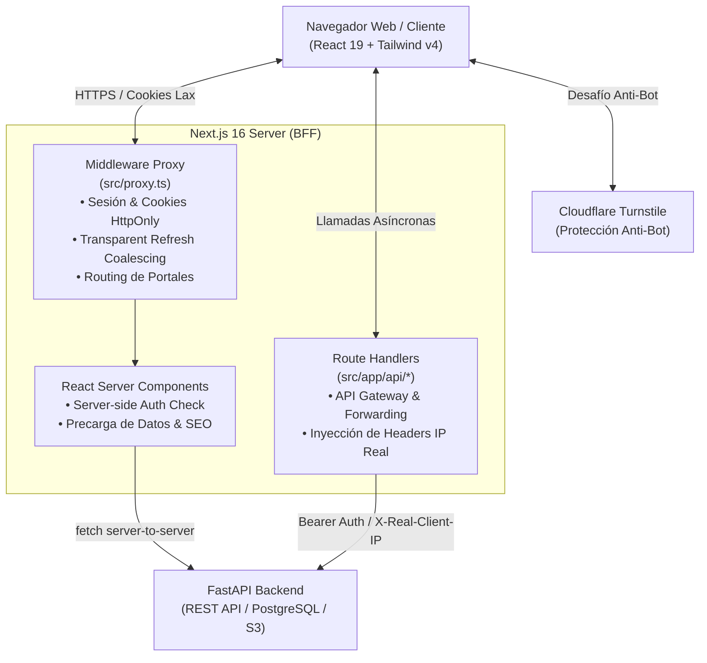

# 01. Arquitectura y Estructura del Proyecto

## 1. Visión General del Sistema

**ISC ATS Frontend** (`integrity-portal-frontend`) es la interfaz de usuario moderna y de alto rendimiento para el sistema de reclutamiento y selección de personal (**Applicant Tracking System - ATS**) y la **Bolsa de Empleo** de **Integrity Solutions Consulting**.

El sistema está diseñado para conectar fluidamente a dos audiencias principales dentro de una sola aplicación web unificada:
1. **Público y Candidatos**: Búsqueda abierta de empleo, registro guiado, onboarding con lectura inteligente de hojas de vida, seguimiento de postulaciones en tiempo real y selección de horarios de entrevistas.
2. **Equipo de Reclutamiento y Staff**: Tableros Kanban de selección, evaluación con Inteligencia Artificial, agendamiento de entrevistas, banco centralizado de talento, generación de documentos ejecutivos de perfil y administración general del sistema (empresas clientes, procesos, plantillas y permisos RBAC).

---

## 2. Arquitectura de Software

La aplicación sigue el patrón **BFF (Backend-for-Frontend)** utilizando las capacidades del **App Router de Next.js 16**, sirviendo como intermediario seguro entre el navegador del usuario y la API REST principal desarrollada en **FastAPI**.



### Principios Fundamentales de la Arquitectura
- **Aislamiento de Tokens (Security Boundary)**: Los tokens de autenticación JWT (`access-token` y `refresh-token`) son estrictamente `HttpOnly` y jamás se exponen al JavaScript del navegador.
- **Rutas por Portal con Redirección Automática**: El middleware inspecciona la cookie contextual `session-user` y el estado del usuario (perfil completo o pendiente de onboarding, cambio obligatorio de contraseña) para garantizar que candidatos y staff solo naveguen en sus áreas autorizadas.
- **Renderizado Híbrido**: Server Components (RSC) para layouts, metadata, prefetching y seguridad inicial; Client Components para interactividad compleja (Kanban Drag-and-Drop, filtros interactivos, modales y formularios reactivos).
- **CSS-First con Tailwind v4**: Centralización de los Design Tokens directamente en CSS nativo (`globals.css`), facilitando temas dinámicos y compatibilidad nativa con CSS variables sin archivo `tailwind.config.ts`.

---

## 3. Estructura de Directorios

La estructura del proyecto organiza responsabilidades según la arquitectura modular basada en características (**Feature-Driven Design**) combinada con un **Design System** atómico:

```
isc-ats-frontend/
├── .github/
│   └── workflows/
│       └── deploy.yml          # Pipeline CI/CD GitHub Actions (GHCR + Dokploy)
├── docs/                       # Documentación técnica exhaustiva
├── public/                     # Recursos estáticos e identidad visual (logos, banners)
├── src/
│   ├── app/                    # Next.js App Router (Páginas, Layouts y API Routes)
│   │   ├── (candidate)/        # Portal del Candidato (/candidato/*)
│   │   ├── (public)/           # Páginas Públicas (/empleos, /login, /registro, etc.)
│   │   ├── (staff)/            # Portal Interno Staff (/vacantes, /entrevistas, etc.)
│   │   ├── api/                # Endpoints BFF que hacen proxy al backend
│   │   ├── cambiar-contrasena/ # Flujo forzado de contraseña temporal
│   │   ├── layout.tsx          # Layout raíz con Providers y Consentimiento de Cookies
│   │   └── icon.svg / favicon  # Favicon y branding web
│   ├── design-system/          # Sistema de Diseño UI (Atomic Design)
│   │   ├── atoms/              # Avatar, Brand, Select, Spinner, FieldError
│   │   ├── molecules/          # Modales, Tabs, Combobox, FilterBar, Turnstile
│   │   ├── organisms/          # Header, Sidebar, DataTable, VacancyCard, VacancyDetail
│   │   ├── templates/          # AuthLayout, PortalLayout
│   │   └── ui/                 # Primitivas base tipo Shadcn (button, input, card, dialog)
│   ├── features/               # Módulos de Negocio independientes
│   │   ├── auth/               # Proveedor de permisos, login, registro, recuperación
│   │   ├── candidate-portal/   # Onboarding, Mi Perfil, Mis Postulaciones
│   │   ├── candidates/         # Ficha del candidato, análisis IA, notas, salarios
│   │   ├── client-companies/   # Vista de empresas clientes sincronizadas
│   │   ├── contacts/           # Contactos de empresas clientes
│   │   ├── cookies/            # Banner y registro de cookies de privacidad
│   │   ├── dashboard/          # Métricas, entrevistas del día y postulantes
│   │   ├── direct-cv-converter/# Herramienta IA de conversión rápida PDF -> Word
│   │   ├── interviews/         # Agenda global, horarios de disponibilidad y estados
│   │   ├── legal/              # Términos, Políticas de Privacidad y Cookies
│   │   ├── notifications/      # Campana de alertas en tiempo real
│   │   ├── parameters/         # Catálogos de departamentos y parámetros generales
│   │   ├── pipeline/           # Tablero Kanban, drag & drop, descarte con motivo
│   │   ├── processes/          # Flujos y fases de selección configurables
│   │   ├── profile-templates/  # Plantillas de perfiles de cargo
│   │   ├── public/             # Componentes de la bolsa de empleos pública
│   │   ├── roles/              # Gestión de roles y matriz granular de permisos
│   │   ├── subscribers/        # Suscriptores de avisos de vacantes
│   │   ├── talent-pool/        # Banco de talento general
│   │   ├── users/              # Gestión de usuarios administrativos/staff
│   │   └── vacancies/          # Creación, edición, filtros y tabs de vacantes
│   ├── lib/                    # Utilidades de servidor, autenticación y fetch
│   │   ├── authCookies.ts      # Manejo de cookies seguras access/refresh
│   │   ├── backendFetch.ts     # Wrapper server-side con auto-refresh de tokens
│   │   ├── backendPages.ts     # Paginación recursiva automática de endpoints backend
│   │   ├── clientIp.ts         # Resolución de IP real contra proxies reversos
│   │   ├── decodeUserId.ts     # Decodificador de tokens JWT en servidor
│   │   ├── internalBaseUrl.ts  # Resolución de URLs internas entre servicios Docker
│   │   ├── rolePermissions.ts  # Algoritmo de sincronización diferencial de permisos
│   │   ├── sessionCookie.ts    # Estructura y ciclo de vida de sesión no confidencial
│   │   └── userMessage.ts      # Formateo amigable de errores del backend
│   ├── providers/              # TanStack React Query Client Provider
│   ├── shared/                 # Constantes, tipos transversales, hooks y validadores
│   │   ├── constants/          # Rutas centralizadas (`ROUTES`) y navegación (`PORTAL_NAV`)
│   │   ├── hooks/              # Hooks reutilizables (usePagedData, etc.)
│   │   ├── stores/             # Zustand stores (breadcrumbs, navegación entre fichas)
│   │   ├── types/              # Tipos compartidos (pipeline, match, estados)
│   │   └── utils/              # Validadores para Ecuador (Cédula Registro Civil, teléfonos)
│   ├── proxy.ts                # Middleware de routing, autorización y token refresh
│   └── globals.css             # Configuración Tailwind CSS v4 y tokens de diseño
├── Dockerfile                  # Construcción multi-stage de producción (standalone)
├── Dockerfile.dev              # Contenedor para desarrollo local con hot-reload
├── next.config.ts              # CSP, Cabeceras de seguridad y configuración standalone
├── package.json                # Dependencias y scripts de ejecución
└── tsconfig.json               # Configuración TypeScript con alias `@/*`
```

---

## 4. Convenciones de Enrutamiento (Next.js App Router)

El enrutamiento aprovecha los **Route Groups** de Next.js (carpetas entre paréntesis `(grupo)`) para aplicar layouts diferenciados sin alterar la URL visible:

| Grupo de Rutas | Segmento URL | Audiencia / Acceso | Layout / Experiencia |
|---|---|---|---|
| `(public)` | `/empleos`, `/login`, `/registro`, `/recuperar-contrasena` | Público general | Tema corporativo Integrity Dark Navy (`--public-bg`), sin requerir sesión |
| `(candidate)` | `/candidato/onboarding`, `/candidato/vacantes`, `/candidato/mi-perfil` | Candidatos con sesión | TopNav y BottomNav responsivo para smartphones |
| `(staff)` | `/`, `/vacantes`, `/entrevistas`, `/banco-talento`, `/configuracion/*` | Reclutadores, Administradores, Staff | PortalLayout con Sidebar colapsable, Header con notificaciones y control RBAC |
| `api/` | `/api/*` | Cliente -> BFF | Endpoints sin interfaz que intermedian llamadas al backend |
| Especial | `/cambiar-contrasena` | Usuarios con contraseña temporal | Gate obligatorio que impide navegar a cualquier otro portal |

---

## 5. Capa de Integración Backend (BFF)

Las llamadas desde el navegador nunca van directamente a la API de FastAPI. Todas pasan a través de los **Route Handlers** de Next.js en `src/app/api/...`:

1. **Inyección de Identidad**: El Route Handler lee la cookie `access-token` (HttpOnly) y la adjunta en el encabezado `Authorization: Bearer <token>`.
2. **Propagación de IP Real (`clientIpHeader`)**: Inspecciona `x-forwarded-for` para enviar al backend la cabecera `X-Real-Client-IP`, garantizando que el rate limiting del backend afecte al usuario final y no a la instancia de Next.js.
3. **Manejo Uniforme de Errores (`BackendError`)**: Si FastAPI responde con error 400, 404, 409 o 422, la clase `BackendError` extrae el campo `detail` estructurado de FastAPI y lo reenvía con su código HTTP original hacia la interfaz cliente.
