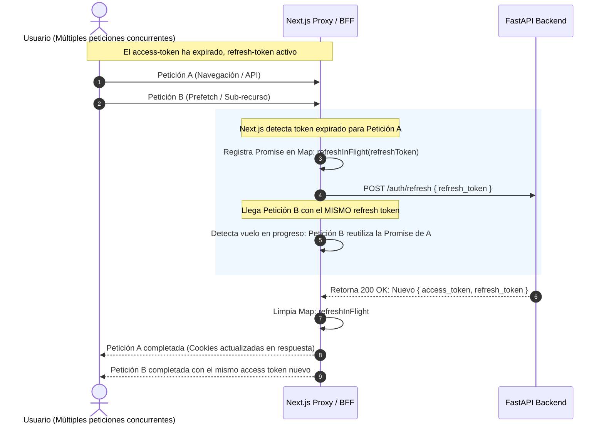

# 02. Autenticación, Seguridad y Control de Acceso (RBAC)

## 1. Esquema de Autenticación y Cookies

El sistema implementa una arquitectura de autenticación robusta basada en **JSON Web Tokens (JWT)** gestionada enteramente a través de cookies seguras desde el servidor Next.js.

### Cookies del Sistema

| Nombre de Cookie | Tipo | Expiración | Propósito |
|---|---|---|---|
| `access-token` | `HttpOnly`, `Secure` (prod), `SameSite: Lax` | Corta (~15-60 min) | Token portador (Bearer JWT) para autorizar peticiones al backend FastAPI. |
| `refresh-token` | `HttpOnly`, `Secure` (prod), `SameSite: Lax` | Larga (7 días) | Token de rotación única para renovar el par de tokens sin desconectar al usuario. |
| `session-user` | No `HttpOnly`, `SameSite: Lax` | 7 días (sincronizada) | JSON no confidencial (`{ portal, has_profile, must_change_password, name, initials, userId }`) para decisiones de renderizado y enrutamiento visual en el cliente. |

> [!IMPORTANT]
> **Principio de Mínimo Privilegio**: La cookie `session-user` es solo un asistente de interfaz de usuario (UX router), **no una frontera de confianza criptográfica**. Si el usuario altera su valor, el middleware solo modificará a qué pantalla intenta dirigirlo; cualquier dato real o mutación es validada exclusivamente por FastAPI validando el `access-token` firmado.

---

## 2. Refresco Transparente de Tokens y Prevención de Carreras (Race Conditions)

El backend de FastAPI utiliza **rotación de tokens de refresco al usarse** (un refresh token queda invalidado tan pronto como se canjea por uno nuevo). Esto genera un problema común en aplicaciones web modernas: cuando un usuario tiene varias pestañas abiertas o cuando una sola página ejecuta múltiples peticiones en paralelo (`Promise.all`), varias peticiones podrían intentar refrescar con el mismo token antiguo, resultando en errores 401 que expulsan injustamente al usuario al login.

Para resolver esto, el sistema implementa una cola de coalescencia en memoria (`refreshInFlight`):

### Seguridad en la Coalescencia
La promesa se almacena **estrictamente por valor de refresh token** (`Map<string, Promise>`). Esto evita fugas de identidad entre diferentes usuarios en entornos multihilo o concurrentes de Node.js, garantizando que un usuario jamás reciba un token emitido para otro.

---

## 3. Middleware de Enrutamiento (`src/proxy.ts`)

El proxy de Next.js intercepta cada navegación antes de renderizar la página y aplica las siguientes reglas de negocio deterministas:

1. **Usuarios No Autenticados**:
   - Acceso permitido a rutas públicas: `/empleos`, `/empleos/[id]`, `/login`, `/registro`, `/recuperar-contrasena`, `/restablecer-contrasena`.
   - Si intentan entrar a `/`, se redirige automáticamente a la bolsa pública `/empleos`.
   - Si intentan entrar a cualquier ruta protegida, se redirige a `/login?returnTo=<ruta_original>`, preservando su intención original.
2. **Cambio Obligatorio de Contraseña (`must_change_password`)**:
   - Si la cuenta fue creada con clave temporal o restablecida, cualquier intento de navegación es interceptado y forzado hacia `/cambiar-contrasena`.
3. **Aislamiento de Portales**:
   - **Candidatos**: Solo tienen permitido el acceso a `/candidato/*` y a `/empleos*`. Si intentan entrar a rutas de staff (`/`, `/vacantes`), son reenviados a su portal.
   - **Gate de Onboarding de Candidato**: Si el candidato tiene `has_profile: false`, es retenido en `/candidato/onboarding` y no puede ver `/candidato/vacantes`. Una vez completado el perfil, no puede volver a onboarding.
   - **Staff**: Si un usuario de staff intenta entrar a `/candidato/*`, es redirigido a la raíz `/` de la consola de reclutamiento.

---

## 4. Políticas de Seguridad de Red y Cabeceras (CSP)

Configuradas en `next.config.ts`, aplican estándares modernos de endurecimiento web:

- **Content-Security-Policy (CSP)**:
  - `default-src 'self'`
  - `frame-ancestors 'none'` (Protección total contra Clickjacking).
  - `object-src 'none'`, `base-uri 'self'`.
  - Integración nativa con **Cloudflare Turnstile**: URLs de scripts, iframes y conexiones permitidas explícitamente hacia `https://challenges.cloudflare.com`.
- **Strict-Transport-Security (HSTS)**: `max-age=63072000; includeSubDomains; preload` (fuerza HTTPS estricto por 2 años).
- **X-Frame-Options**: `DENY`.
- **X-Content-Type-Options**: `nosniff`.
- **Referrer-Policy**: `strict-origin-when-cross-origin`.
- **Permissions-Policy**: Restricción explícita de hardware sensible: `camera=(), microphone=(), geolocation=()`.
- **Powered-By Header**: Desactivado (`poweredByHeader: false`) para no exponer información técnica de Next.js a potenciales atacantes.

---

## 5. Control de Acceso Basado en Roles (RBAC)

El frontend complementa la seguridad del backend con una capa de **UX Defense-in-Depth**.

### Catálogo de Permisos (`src/features/auth/permissions.ts`)
Los permisos se organizan bajo nomenclatura jerárquica:
- Módulo Vacantes: `recruitment.vacancies.read`, `create`, `update`, `delete`, `publish`.
- Módulo Postulaciones: `recruitment.applications.create`, `update`, `delete`, `recruitment.application_notes.create`.
- Módulo Entrevistas: `recruitment.interviews.read_agenda`, `create`, `recruitment.interviewer_availability.read`.
- Módulo Banco de Talento: `talent.talent_pool.read`.
- Módulo Organización y Configuración: `org.profile_templates.read`, `org.processes.read`, `org.client_companies.read` / `create`, `org.contacts.*`, `org.parameters.read`, `org.departments.*`.
- Módulo Administración: `auth.users.read`, `auth.roles.read`, `auth.subscribers.read`.
- Funcionalidades IA: `ai.vacancy_promo_images.create`, `delete`.

### Componentes de Control de Acceso
1. **`PermissionsProvider`**: Inyecta los permisos del usuario actual en el contexto de React en el layout raíz del portal staff (`src/app/(staff)/layout.tsx`).
2. **`AccessGuard`**: Envuelve las páginas de staff. Compara la ruta solicitada con la tabla de prefijos `ROUTE_PERMISSIONS`. Si el usuario carece del permiso de lectura correspondiente, muestra una pantalla de acceso denegado amigable.
3. **`PortalSidebar`**: Evalúa los ítems de navegación contra `usePermissions()`. Si el usuario no tiene el permiso, el ítem simplemente no se dibuja en el menú.

### Algoritmo de Sincronización Diferencial (`computeRolePermissionSync`)
Al editar un rol en `/configuracion/roles`:
- El frontend calcula un plan diferencial `{ toGrant: number[], toRevoke: number[] }`.
- **Invariante Crítico de Seguridad**: Solo se consideran para revocación los códigos de permiso que pertenecen a `knownCodes` (el catálogo realmente visualizado por la pantalla). Si existen permisos internos u ocultos en el backend no presentados en la interfaz, **jamás son revocados por accidente**.

---

## 6. Validaciones Especiales de Identidad y Contacto

Ubicadas en `src/shared/utils/ecuadorValidators.ts`:
- **Algoritmo Cédula Ecuatoriana (`validateCedulaEC`)**:
  - Verifica longitud exacta de 10 dígitos numéricos.
  - Valida código de provincia (01 a 24).
  - Valida que el tercer dígito corresponda a personas naturales (< 6).
  - Ejecuta el algoritmo de módulo 10 oficial del Registro Civil de Ecuador con coeficientes `[2, 1, 2, 1, 2, 1, 2, 1, 2]`.
- **Validación de Pasaporte (`validatePassport`)**: Permite formatos internacionales alfanuméricos de 6 a 20 caracteres.
- **Validación de Teléfonos Móviles (`validatePhoneEC` / `validatePhone`)**: Soporta formato local Ecuador (`09XXXXXXXX`), con código de país (`+5939XXXXXXXX`) o formato estándar internacional ITU-T E.164.
- **Política de Contraseñas**: Mínimo 8 caracteres, validación simétrica a las reglas del backend.
