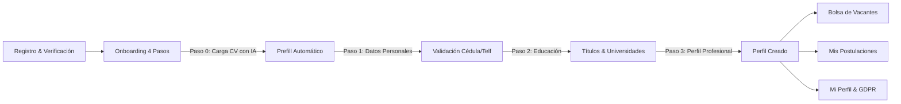
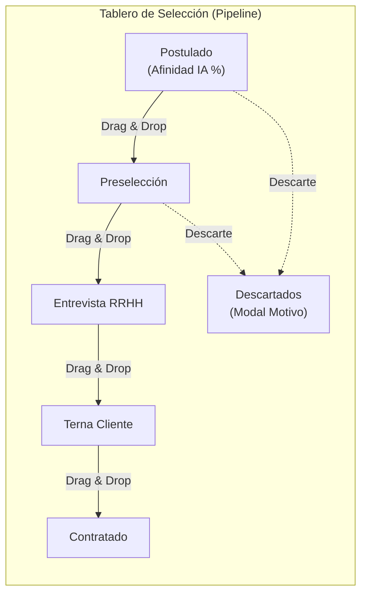

# 03. Módulos y Funcionalidades del Sistema

## 1. Portal Público y Candidatos (`(public)`)

El portal público está diseñado para ofrecer una experiencia rápida, moderna y libre de fricciones a personas en búsqueda de oportunidades de empleo en Integrity Solutions Consulting y sus empresas clientes.

### 1.1 Bolsa de Empleos (`/empleos` y `/empleos/[id]`)
- **Exploración de Oportunidades**: Lista de vacantes activas y publicadas con filtros por cargo, modalidad (presencial, híbrido, remoto), ubicación y fecha de publicación.
- **Detalle de la Vacante**: Ficha completa del puesto con responsabilidades, requisitos obligatorios/deseables, beneficios y rango salarial (si aplica).
- **Flujo de Postulación Inteligente**:
  - Si el usuario no tiene sesión activa, el botón de postular guarda la vacante en `returnTo` y lo conduce a registrarse o iniciar sesión.
  - Si el usuario ya completó su onboarding, la postulación se realiza en un solo clic.

### 1.2 Flujo de Autenticación y Registro Seguro
- **Registro con Protección Anti-Bot**: Formulario con validación en tiempo real y widget invisible/interactivo de **Cloudflare Turnstile**.
- **Verificación de Correo Electrónico (`/registro/verificacion`)**: Confirmación mediante token seguro enviado por email.
- **Opción de Reenvío de Enlace**: Si el usuario intenta iniciar sesión con una cuenta aún no verificada, la pantalla de login detecta el estado y ofrece un botón inmediato para reenviar el enlace de activación.
- **Recuperación de Contraseña**: Flujo de autoservicio (`/recuperar-contrasena` y `/restablecer-contrasena`) mediante enlace temporal de un solo uso.
- **Cambio Obligatorio de Contraseña (`/cambiar-contrasena`)**: Intercepta a los usuarios cuyas credenciales fueron creadas administrativamente con contraseña provisional.

---

## 2. Portal Privado del Candidato (`(candidate)`)

Diseñado con un layout móvil-first (con barra de navegación inferior `BottomNav` para dispositivos móviles y cabecera superior `TopNav` para pantallas grandes).

### 2.1 Onboarding Guiado en 4 Pasos (`/candidato/onboarding`)
El candidato no puede acceder a las vacantes internas ni postularse hasta completar su perfil base:
1. **Paso 0 - Carga de Hoja de Vida**: El candidato sube su archivo PDF (máx. 5 MB). El endpoint `/api/candidate/cv/prefill` utiliza el motor de IA del backend para extraer automáticamente su nombre, identificación, experiencia y educación previa, rellenando los pasos posteriores sin esfuerzo manual.
2. **Paso 1 - Datos Personales**: Nombres, apellidos, número de identificación (validado con el algoritmo oficial de cédula ecuatoriana o pasaporte), teléfono de contacto, dirección y fecha de nacimiento.
3. **Paso 2 - Formación Académica**: Nivel de educación (Secundaria, Tercer Nivel, Cuarto Nivel), título obtenido, institución educativa y estado de estudio (graduado o en curso).
4. **Paso 3 - Resumen Profesional**: Extracto de perfil profesional, pretensión salarial y años de experiencia.

### 2.2 Gestión de Perfil y Privacidad (`/candidato/mi-perfil`)
- **Datos Personales (`PersonalInfoCard`)**: Actualización de información de contacto e identificación.
- **Hoja de Vida (`ResumeCard`)**: Sustitución de archivo CV en PDF y descarga del archivo actual.
- **Seguridad de la Cuenta (`SecurityCard`)**: Cambio de contraseña con validación de contraseña actual y nueva.
- **Preferencias de Consentimiento (`MarketingConsentCard`)**: Control voluntario para recibir avisos de nuevas vacantes por correo o WhatsApp.
- **Zona de Peligro / Derecho al Olvido (`DangerZoneCard`)**: Diálogo de confirmación con doble verificación para la **eliminación definitiva de la cuenta**, conforme a las normativas de protección de datos personales.

### 2.3 Mis Postulaciones (`/candidato/mis-postulaciones`)
- Vista unificada del estado de cada proceso de selección al que el usuario ha aplicado.
- **Selección de Horario de Entrevistas (Modo B)**: Cuando el equipo de reclutamiento envía una propuesta con múltiples opciones horarias, el candidato puede elegir y confirmar en tiempo real el bloque horario que mejor se adapte a su disponibilidad.

---

## 3. Portal Staff y Reclutamiento (`(staff)`)

El entorno de trabajo para el equipo de Recursos Humanos, reclutadores, líderes de área y administradores.

### 3.1 Dashboard Ejecutivo (`/`)
- **Métricas Clave**: Número de vacantes abiertas, candidatos activos en procesos, tasa de avance y postulaciones de la semana.
- **Agenda de Entrevistas**: Bloque destacado con las entrevistas programadas para **Hoy** y **Mañana** (calculadas en horario local de Ecuador `UTC-5`).
- **Embudo de Candidatos**: Resumen del volumen de postulantes según afinidad y etapas del proceso.

### 3.2 Gestión de Vacantes (`/vacantes`)
- **Creación y Edición Guiada**: Formulario modular con validaciones Zod:
  - Información básica: nombre del puesto, empresa cliente (`client_company`), departamento (`department`), contacto del cliente (`contact`), código y número de vacantes disponibles.
  - Condiciones de empleo: modalidad, rango salarial, experiencia requerida.
  - Selección de Proceso y Plantilla: vinculación de la vacante a una plantilla de perfil de cargo y a un flujo de selección específico.
- **Pestañas de la Vacante (`/vacantes/[id]`)**:
  1. **Pipeline**: Tablero de selección interactivo.
  2. **Detalles**: Información descriptiva, requisitos técnicos y habilidades requeridas.
  3. **Documentos**: Historial de informes de perfil generados para el cliente.
  4. **Imágenes**: Generador y galería de artes promocionales generados con IA para redes sociales.

### 3.3 Tablero Kanban de Selección (Pipeline)
Desarrollado sobre `@dnd-kit/core` y `@dnd-kit/sortable`:

- **Tarjetas de Candidatos (`CandidateCard`)**: Muestran nombre, iniciales con color de avatar distintivo, porcentaje de afinidad / match calculado por IA, ciudad de residencia, universidad, pretensión salarial y tiempo transcurrido desde la última actualización.
- **Filtros Avanzados y Persistentes (`PipelineFilterBar`)**:
  - Búsqueda en vivo por nombre del candidato.
  - Filtro por institución universitaria.
  - Filtro por años de experiencia y rango salarial.
  - Filtro por actividad reciente (últimos 3 días, 7 días, etc.).
  - Los filtros se conservan en la URL para permitir compartir vistas exactas del tablero.
- **Motivos de Descarte (`RejectReasonDialog`)**: Al arrastrar un candidato a la columna de descarte o ejecutar la acción manual, se exige seleccionar el motivo categorizado (e.g. "Pretensión salarial fuera de rango", "No cumple requisitos técnicos", "No asistió a entrevista") para alimentar las estadísticas de selección.

### 3.4 Expediente del Candidato en Vacante (`/vacantes/[id]/candidato/[candidateId]`)
- **Navegación Secuencial**: Barra superior que permite avanzar al siguiente o anterior candidato en la lista sin tener que regresar al tablero Kanban, conservando los filtros aplicados.
- **Evaluación y Matching Asistido por IA (`AIAnalysisCard`)**:
  - Porcentaje general de compatibilidad.
  - Justificación cualitativa redactada por el motor de IA.
  - Puntos fuertes (fortalezas detectadas contra el perfil del cargo).
  - Brechas y aspectos por validar durante la entrevista técnica.
- **Hoja de Vida en Formato Corporativo Integrity**: Botón de generación en un solo clic que produce un archivo Microsoft Word (`.docx`) formal y estructurado con el membrete oficial de Integrity Solutions, listo para enviar al cliente contratante.
- **Notas del Reclutador (`NotesCard`)**: Registro cronológico de observaciones internas compartidas entre el equipo de selección.
- **Gestión de Estado (`StatusSidebar`)**: Acciones rápidas para cambiar de fase, agendar entrevista o descartar con motivo.

### 3.5 Agenda y Agendamiento de Entrevistas (`/entrevistas`)
- **Ventanas de Disponibilidad Recurrente**: Los entrevistadores pueden registrar sus horarios habituales de disponibilidad semanal (día, rango horario, duración del bloque y tiempo de descanso entre entrevistas).
- **Dos Modos de Agendamiento**:
  - **Modo A (RH Selecciona)**: El reclutador escoge directamente la fecha, hora e interlocutor de la reunión y la cita queda confirmada.
  - **Modo B (Candidato Elige)**: El reclutador selecciona varias alternativas viables y el sistema genera una invitación para que el candidato confirme la opción deseada desde su portal.
- **Integración con Microsoft Teams**: Generación de URLs de reunión virtual en Teams para enlaces remotos.

### 3.6 Banco de Talento (`/banco-talento`)
- Repositorio transversal de candidatos que han aplicado a cualquier vacante histórica o se han registrado espontáneamente.
- Buscador global por palabras clave, habilidades técnicas, ubicación y disponibilidad.
- Posibilidad de incorporar candidatos del banco directamente a nuevas vacantes abiertas sin requerir un nuevo registro.

### 3.7 Conversor Directo de Hojas de Vida (`/convertir-cv`)
- Herramienta de productividad rápida para el equipo de reclutamiento:
  1. Permite arrastrar cualquier archivo PDF de currículum vitae externo (hasta 5 MB).
  2. Llama al servicio de Inteligencia Artificial para extraer y categorizar datos (experiencia, fechas, responsabilidades, herramientas, certificaciones y habilidades blandas).
  3. Previsualiza la información extraída en pantalla.
  4. Permite la descarga instantánea en formato `.docx` estandarizado de Integrity.

---

## 4. Módulo de Configuración y Administración

Accesible según la matriz de roles y permisos RBAC:

| Submódulo | Ruta | Funcionalidad |
|---|---|---|
| **Plantillas de Cargo** | `/configuracion/plantillas` | Creación de descripciones de puestos estandarizadas (objetivos, responsabilidades, competencias técnicas y requerimientos académicos). |
| **Procesos de Selección** | `/configuracion/procesos` | Modelado de etapas y secuencias de reclutamiento (e.g. Filtro telefónico -> Prueba técnica -> Entrevista final). |
| **Empresas Clientes** | `/configuracion/clientes` | Catálogo centralizado de empresas contratantes sincronizadas desde el sistema comercial. |
| **Contactos** | `/configuracion/contactos` | Directorio de interlocutores y tomadores de decisión por cada empresa cliente. |
| **Catálogos y Parámetros** | `/configuracion/catalogos` | Administración de departamentos, tipos de contrato, niveles de experiencia y parámetros maestros del sistema. |
| **Usuarios Staff** | `/configuracion/usuarios` | Alta, baja y asignación de roles a miembros del equipo interno. |
| **Roles y Permisos** | `/configuracion/roles` | Editor granular de roles del sistema con matriz de permisos activables/desactivables. |
| **Suscriptores** | `/configuracion/suscriptores` | Gestión y exportación en CSV de candidatos suscritos al boletín de nuevas oportunidades laborales. |
