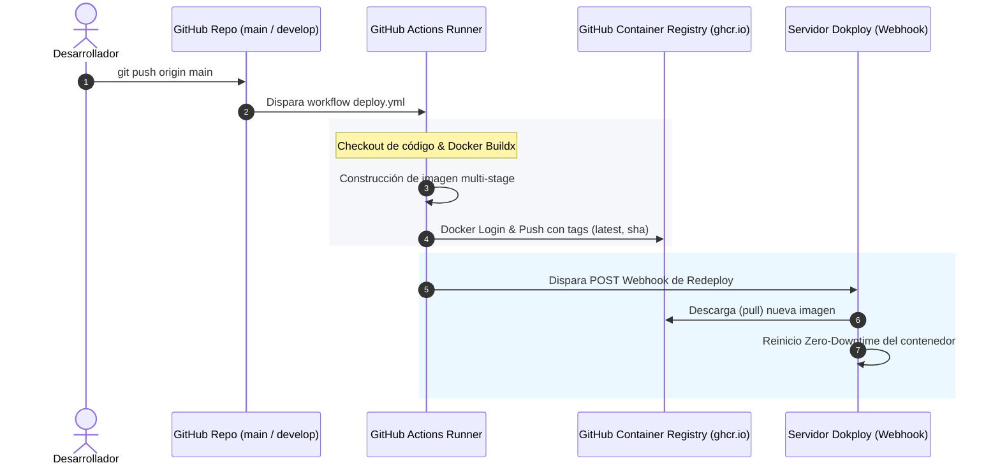

# 05. Despliegue, Infraestructura y Operaciones

## 1. Variables de Entorno

La aplicación requiere un conjunto mínimo de variables de entorno configuradas tanto en desarrollo local (`.env.local`) como en el servidor de producción (Dokploy):

| Variable | Ámbito | Descripción | Ejemplo Local | Ejemplo Dokploy (Docker) |
|---|---|---|---|---|
| `BACKEND_INTERNAL_URL` | Servidor (Node.js) | URL interna de la API FastAPI alcanzable por el servidor Next.js. | `http://localhost:8000/api/v1` | `http://backend-api:8000/api/v1` |
| `NEXTJS_INTERNAL_URL` | Servidor (Node.js) | URL interna de la propia instancia de Next.js para llamadas absolutas en RSC y Route Handlers. | `http://localhost:3000` | `http://frontend:3000` |
| `TURNSTILE_SITE_KEY` | Servidor / Prop Cliente | Clave pública de sitio de Cloudflare Turnstile para el widget anti-bot. Se pasa como prop desde el servidor (no requiere prefijo `NEXT_PUBLIC_`). | `1x00000000000000000000AA` (clave de prueba) | Clave pública emitida por Cloudflare |

> [!NOTE]
> Las credenciales de base de datos, claves secretas JWT y `TURNSTILE_SECRET_KEY` viven exclusivamente en el backend FastAPI y **nunca deben declararse en este repositorio**.

---

## 2. Configuración Docker

### 2.1 Imagen de Producción Multi-Stage (`Dockerfile`)
La compilación de producción optimiza el tamaño y la seguridad utilizando la salida **standalone** de Next.js (`output: 'standalone'` en `next.config.ts`):

```dockerfile
# Etapa 1: Builder
FROM node:20-alpine AS builder
WORKDIR /app
COPY package*.json ./
RUN npm ci
COPY . .
ENV NEXT_TELEMETRY_DISABLED=1
RUN npm run build

# Etapa 2: Runner de Producción
FROM node:20-alpine AS runner
WORKDIR /app
ENV NODE_ENV=production
ENV NEXT_TELEMETRY_DISABLED=1

# Usuario sin privilegios por seguridad
RUN addgroup --system --gid 1001 nodejs && adduser --system --uid 1001 nextjs

# Copia solo los artefactos standalone y recursos públicos
COPY --from=builder /app/public ./public
COPY --from=builder --chown=nextjs:nodejs /app/.next/standalone ./
COPY --from=builder --chown=nextjs:nodejs /app/.next/static ./.next/static

USER nextjs
EXPOSE 3000
ENV PORT=3000
ENV HOSTNAME=0.0.0.0

CMD ["node", "server.js"]
```

### 2.2 Ejecución con Docker Compose (`docker-compose.yml`)

El repositorio incluye un archivo [`docker-compose.yml`](file:///C:/Users/jonathan.alejandro/Documents/tmr2/isc-ats-frontend/docker-compose.yml) configurado para levantar el entorno de desarrollo y conectarlo automáticamente con la red interna del backend (`isc-ats-backend_default`):

```bash
# Levantar el frontend con Docker Compose
docker compose up -d

# Ver logs en tiempo real
docker compose logs -f

# Detener el contenedor
docker compose down
```

### 2.3 Ventajas de la Imagen Standalone
- **Tamaño Ultra Ligero**: En lugar de empaquetar toda la carpeta `node_modules` (~400+ MB), Next.js realiza un traceo de dependencias para incluir únicamente los módulos necesarios en `server.js` (~70 MB).
- **Seguridad**: Ejecuta bajo el usuario de sistema `nextjs` (sin privilegios root).
- **Arranque Inmediato**: Se inicia directamente con `node server.js` sin requerir el CLI de `next start`.

---

## 3. Pipeline CI/CD con GitHub Actions y Dokploy

El despliegue está 100% automatizado mediante el flujo `.github/workflows/deploy.yml`:



### Configuración de Secretos en GitHub Repository
Para que el pipeline funcione correctamente, se deben registrar los siguientes secretos en `Settings -> Secrets and variables -> Actions`:
- `DOKPLOY_WEBHOOK_URL`: URL del webhook generado en Dokploy para el servicio de producción (rama `main`).
- `DOKPLOY_WEBHOOK_URL_DEVELOP`: URL del webhook para el entorno de staging/desarrollo (rama `develop`).

---

## 4. Ejecución y Scripts de Desarrollo Local

### Comandos de Terminal

```bash
# 1. Instalar dependencias exactas
npm ci

# 2. Iniciar servidor de desarrollo local
npm run dev

# 3. Ejecutar pruebas unitarias e integración (Vitest)
npm test

# 4. Ejecutar pruebas en modo observador interactivo (watch)
npm run test:watch

# 5. Comprobar estilo y reglas de linter (ESLint 9)
npm run lint

# 6. Compilar paquete para producción
npm run build

# 7. Ejecutar compilación de producción localmente
npm run start
```

---

## 5. Arquitectura de Red y Reverse Proxy (Dokploy / Traefik)

En el servidor de producción:
1. **Traefik** actúa como el balanceador de carga frontal y gestor de certificados SSL Let's Encrypt.
2. Traefik reenvía la petición al contenedor de Next.js en el puerto 3000 añadiendo la cabecera `X-Forwarded-For`.
3. El middleware `src/proxy.ts` y las utilidades `clientIp.ts` extraen la IP pública real del cliente y la forwardean a FastAPI mediante `X-Real-Client-IP`.
4. La comunicación entre Next.js y FastAPI ocurre dentro de la red interna Docker (Docker Bridge/Overlay Network), por lo que no viaja expuesta por internet público.

---

## 6. Guía de Resolución de Problemas (Troubleshooting)

### Error de Cloudflare Turnstile en Login o Registro
- **Síntoma**: El widget no carga o la consola muestra error de Content-Security-Policy.
- **Causa**: Faltan dominios permitidos en CSP o la clave de sitio no es válida.
- **Solución**: Verificar que `next.config.ts` mantenga la constante `CF_TURNSTILE = "https://challenges.cloudflare.com"` en las directivas `script-src`, `frame-src` y `connect-src`. Para pruebas locales, use la clave de prueba oficial de Cloudflare `1x00000000000000000000AA`.

### Bucle de Redirección hacia `/login`
- **Síntoma**: El usuario introduce sus credenciales, pero el sistema lo regresa de inmediato a `/login`.
- **Causa**: Desfase de reloj (clock skew) entre servidores o la cookie `session-user` no pudo crearse mientras que el token de refresco ya expiró.
- **Solución**: El middleware cuenta con auto-recuperación: si detecta token huérfano sin cookie de sesión, purga automáticamente las cookies viejas para permitir un login limpio.

### Fallo al subir archivos grandes en el Conversor de CV
- **Síntoma**: Error 413 "Payload Too Large" o error de red al subir PDF de CV.
- **Causa**: El archivo excede los 5 MB permitidos o el proxy reverso tiene un límite inferior de `client_max_body_size`.
- **Solución**: Verificar que el PDF sea menor a 5 MB (validado en `DirectCvConverter.tsx`) y que la configuración de Traefik o Nginx permita cargas de al menos 10 MB.
